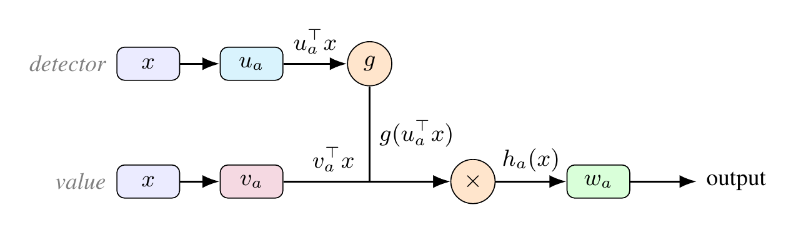

# CP-MLPs: A Tensor-Rank Theory of Tied and Untied MLP Blocks

Code for the NeurIPS 2026 paper

> Md Rifat Arefin, Farzaneh Heidari, Irina Rish, Guillaume Rabusseau.
> *CP-MLPs: A Tensor-Rank Theory of Tied and Untied MLP Blocks.*
> NeurIPS 2026.

<p align="center">
  
</p>

*Figure 1 of the paper. A single CP-MLP channel computes h_a(x) = g(u_aᵀx)(v_aᵀx) and writes the
result through w_a. At each active polynomial degree it contributes one rank-1 CP atom with
detector (u_a), value (v_a) and output (w_a) legs. Tied blocks such as ReLU² and tied SwiGLU set
v_a = u_a; untied blocks such as ReGLU and SwiGLU learn them separately.*

All experiments are small and run on a CPU.

## Installation

```bash
git clone <this repository>
cd cpmlp-tensor-rank
pip install -r requirements.txt
```

PyTorch is only needed for `experiments/appendix/` (autograd and Adam). The CPU build is
enough: `pip install torch --index-url https://download.pytorch.org/whl/cpu`.

## Reproducing the paper

```bash
./reproduce_all.sh            # writes everything to results/
```

The main-text figures take about 5 minutes. The appendix experiments take about
2–3 hours on one core; the slowest are Tables 7 and 8. Every appendix script in
`experiments/appendix/` and `experiments/distillation/` is resumable.

## What each script reproduces

| Paper | Script | Runtime* |
|---|---|---|
| §5.1, Figure 2 — indefinite quadratic targets | `experiments/fig2_indefinite_quadratic.py` | ~1 min |
| §5.2, Figure 3 — coefficient-space width sweep | `experiments/fig3_width_sweep.py` | ~1 min |
| §5.3, Figure 4 — pure powers vs role-asymmetric targets | `experiments/fig4_pure_vs_mixed.py` | <1 min |
| §5.4, Figure 5 — gated MLPs | `experiments/fig5_gated_mlps.py` | <1 min |
| App. D.7, Figure 6, Table 3 — scope boundary | `experiments/fig6_scope_boundary.py` | ~1 min |
| App. D.8, Figure 7 — matched input-projection control | `experiments/fig7_matched_params.py` | <1 min |
| Paper-styled Figures 3–7 from saved results | `experiments/make_figures.py` | seconds |
| App. D.9, Tables 4–5 — border-rank diagnostics | `experiments/d9_border_rank.py` | ~4 min |
| App. D.10, Table 6 — recovery of known representations | `experiments/appendix/e_q3.py` | ~17 min |
| App. D.10, F₄,₂ example | `experiments/d10_f42_example.py` | seconds |
| App. D.11, Table 7 — dense random targets | `experiments/appendix/e_q1a.py` | ~30 min |
| App. D.11, Table 8 — mixtures of degrees | `experiments/appendix/e_q1b.py` | ~1–1.5 h |
| App. D.12, Table 9 — distillation of trained gated blocks | `experiments/distillation/` | ~20 min |
| App. D.13, Table 10 — Adam-trained scalar regression | `experiments/appendix/e_q4.py` | ~3 min |

\*Single core, measured on a cloud machine.

Table 1 (block definitions), Table 2 (hyperparameters) and the theory in Sections 3–4
and Appendices A–C have no code.

## How closely the results match the paper

See [REPRODUCTION.md](REPRODUCTION.md) for a line-by-line comparison. In short:

- **Tables 6, 7 and 10 reproduce exactly** (every printed entry), and Table 8
  reproduces as reported in REPRODUCTION.md.
- **Figures 2–7 and Table 3** reproduce every claim. Only losses already at machine
  precision change, because SciPy ≥ 1.15 uses a rewritten L-BFGS-B.
- **Tables 4–5** were rebuilt from the appendix description. The losses and regimes
  reproduce exactly; the κ column does not (see REPRODUCTION.md).
- **Table 9** uses the original distillation harness, but the paper's final teacher
  settings were not recovered, so it reproduces in pattern rather than entry by entry.

## Repository layout

```
cpmlp/
  helpers.py          activations used by the main-text experiments
  symtensor.py        coefficient-space tied/untied atom fitting with analytic
                      gradients, apolar norm, condition numbers (D.9, D.10 example)
experiments/
  fig*.py             main-text figures and Appendix D.7-D.8
  make_figures.py     paper-styled Figures 3-7
  d9_border_rank.py   Appendix D.9
  d10_f42_example.py  Appendix D.10, F_{4,2} example
  appendix/           original scripts for Tables 6, 7, 8, 10 (see its README)
  distillation/       original harness for Table 9 (see its README)
reproduce_all.sh      runs everything
REPRODUCTION.md       comparison of re-runs against the paper
assets/               Figure 1 (PNG and its TikZ source)
```

## Conventions

- *Tied* blocks share the detector and value directions (`v = u`); *untied* blocks
  learn them separately. Tied SwiGLU is `SiLU(uᵀx)·(uᵀx)`.
- Coefficient-space losses in Figures 3 and 6 use unweighted monomial coordinates;
  Appendix D.9–D.11 use the apolar (Bombieri) norm and report relative errors.
- In `experiments/appendix/`, `n` denotes the number of variables (the paper's `d`).

## Citation

```bibtex
@inproceedings{arefin2026cpmlps,
  title     = {{CP-MLPs}: A Tensor-Rank Theory of Tied and Untied {MLP} Blocks},
  author    = {Arefin, Md Rifat and Heidari, Farzaneh and Rish, Irina and Rabusseau, Guillaume},
  booktitle = {Advances in Neural Information Processing Systems},
  year      = {2026}
}
```

## License

MIT — see [LICENSE](LICENSE).
